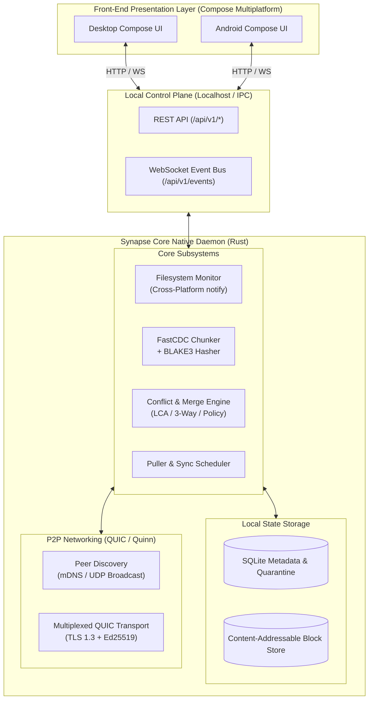
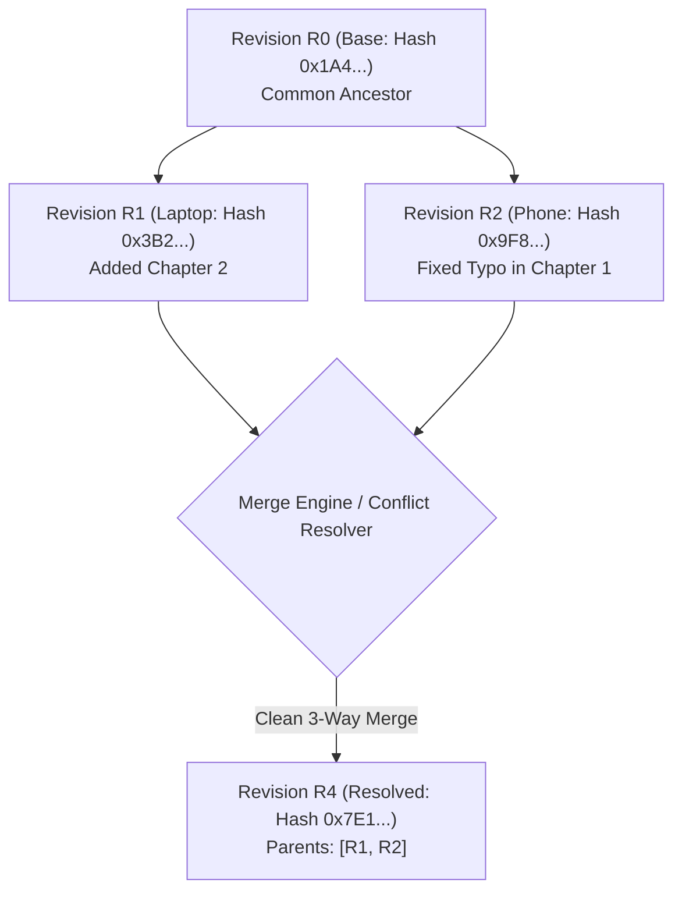
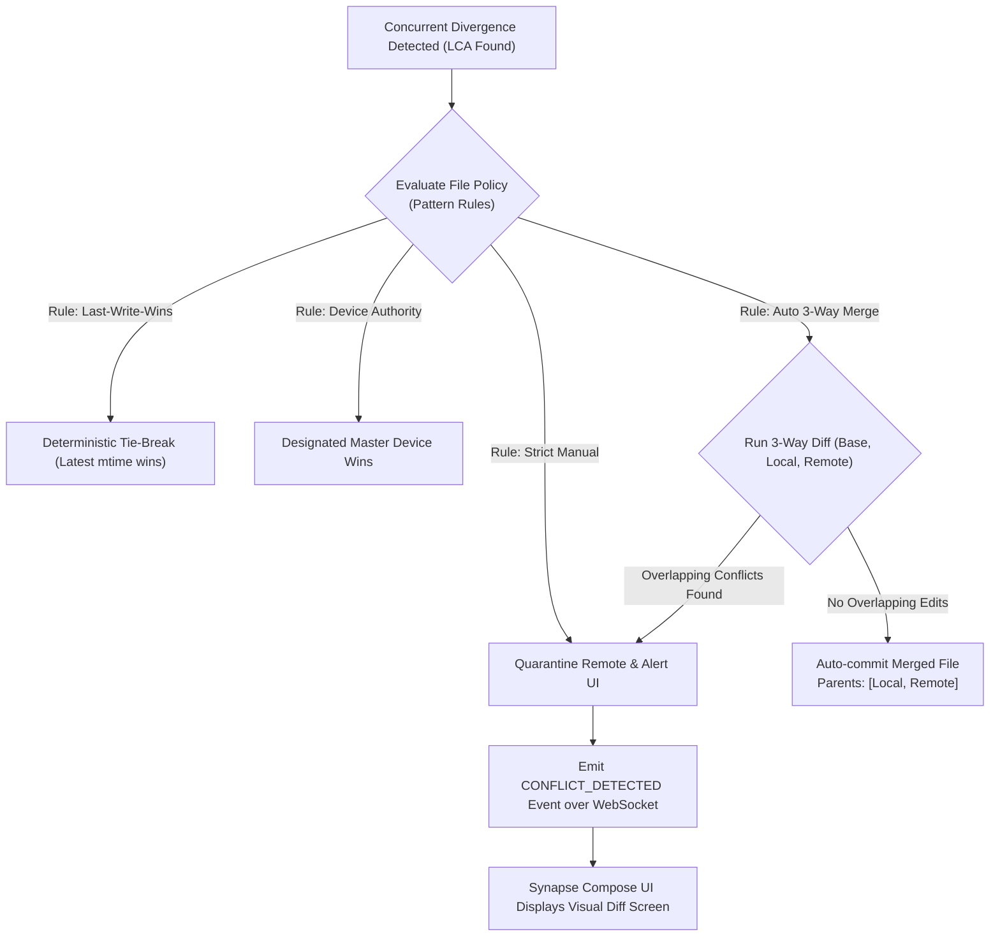
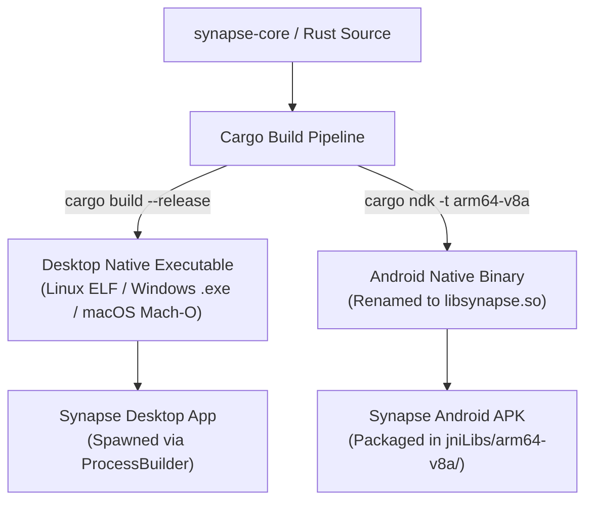

# Synapse Core: Technical Architecture & Specification

**Document Version:** 1.0.0  
**Project:** Synapse Core (Decentralized File Synchronization & Conflict Resolution Engine)  
**Target Platforms:** Linux (x86_64, aarch64), Windows (x64), macOS (Apple Silicon, Intel), Android (arm64-v8a, armeabi-v7a, x86_64)

---

## 1. Executive Summary & Vision

**Synapse Core** is an embedded, peer-to-peer (P2P) continuous file synchronization engine designed to act as the unified native backend for the Synapse ecosystem (Android, Desktop, and Web).

Unlike existing solutions like Syncthing that rely on opaque binary block synchronization and destructive file-renaming conflict policies (`.sync-conflict-*`), Synapse Core is built around **three foundational pillars**:

1. **Non-Polluting Virtual Quarantine:** Conflicting edits never litter the user's filesystem. Conflicting versions are stored in an internal staging cache until reconciled.
2. **True 3-Way Semantic Merging:** By maintaining a lightweight revision Merkle DAG (ancestor tree), the engine identifies the Lowest Common Ancestor (LCA) to automatically merge non-overlapping edits in text, Markdown, CSV, JSON, and code.
3. **Unified Single-Binary Architecture:** A single Rust codebase compiles into both a standalone daemon for PC and an executable shared library (`libsynapse.so`) for Android, sharing 100% of the synchronization and conflict logic.

---

## 2. High-Level System Architecture



---

## 3. Storage & Deduplication Engine (FastCDC + BLAKE3)

### 3.1 Content-Defined Chunking (CDC)
Traditional sync engines divide files into fixed-size blocks (e.g. 128 KiB to 16 MiB). If a single byte is prepended to a file, all downstream block boundaries shift, invalidating the entire chunk index.

Synapse Core utilizes **FastCDC** with a normalized rolling Gear hash:
* **Minimum Chunk Size:** 64 KiB
* **Target / Average Chunk Size:** 512 KiB
* **Maximum Chunk Size:** 2048 KiB

When edits occur inside a file, FastCDC re-synchronizes boundary points dynamically. Only the directly modified chunk(s) generate new hashes; all preceding and succeeding chunks remain byte-identical.

### 3.2 Block Hashing: BLAKE3
Every chunk is cryptographically identified by a **BLAKE3** hash (256-bit). BLAKE3 is selected because:
* It processes at ~4–7 GB/s per core (massively faster than SHA-256 and MD5).
* It is tree-hash based by default, allowing incremental verification of streaming data.

---

## 4. Causality Tracking & The Merkle Revision DAG

Vector Clocks tell a node *that* two versions diverged, but not *how* they diverged or *what* their common ancestor was. Synapse Core implements a lightweight **Merkle Revision DAG** per file.



### 4.1 Revision Node Data Structure
```rust
pub struct RevisionNode {
    pub revision_hash: String,        // BLAKE3(parent_hashes + manifest_hash)
    pub parent_hashes: Vec<String>,   // 1 parent = normal update; 2 parents = merge commit
    pub manifest_hash: String,        // Hash of chunk-list representation
    pub author_device_id: String,     // Public key fingerprint of authoring node
    pub sequence_number: u64,         // Monotonically increasing local counter
    pub mtime_nanos: i64,             // POSIX timestamp in nanoseconds
    pub file_size: u64,               // Total size in bytes
}
```

### 4.2 Lowest Common Ancestor (LCA) Traversal
When local device state $A$ conflicts with incoming remote state $B$:
1. Traverse the parent pointers of $A$ and $B$ backward using breadth-first search (BFS).
2. Find the latest common ancestor $R_{\text{base}}$ where both branches diverged.
3. If $R_{\text{base}} = B$, $A$ is a clean descendant (fast-forward local).
4. If $R_{\text{base}} = A$, $B$ is a clean descendant (fast-forward remote).
5. If $R_{\text{base}} \neq A$ and $R_{\text{base}} \neq B$, trigger the **Conflict Resolution Pipeline** using $R_{\text{base}}$ as the 3-way merge reference.

---

## 5. Multi-Strategy Conflict Resolution Pipeline



### 5.1 Tier 1: Automated 3-Way Semantic Merge
For plain text, Markdown, CSV, and code files:
* Extract lines from $R_{\text{base}}$, $R_{\text{local}}$, and $R_{\text{remote}}$.
* Run a line-level diff3 algorithm (powered by `similar` engine).
* If changes occurred in separate sections of the file, synthesize the merged output automatically, write it to disk, create a 2-parent merge revision, and broadcast the resolved state to all peers.

### 5.2 Tier 2: Quarantine & Virtual Staging (Zero Filesystem Pollution)
When a conflict cannot be safely auto-merged (e.g. overlapping line edits or binary files like images, PDFs, databases):
1. **Disk Integrity:** The user's local working copy is **never** renamed or overwritten.
2. **Quarantine Storage:** The incoming conflicting blocks are assembled into an internal staging folder (`.synapse/quarantine/<conflict_id>.<ext>`) or stored in SQLite.
3. **Database Registration:** An entry is inserted into the `quarantine_conflicts` table.
4. **UI Signal:** The engine pushes a `CONFLICT_DETECTED` event to the connected Synapse UI.

### 5.3 Tier 3: Interactive UI Visual Merge Tool
The Synapse Compose UI receives the conflict notification and presents a side-by-side visual diff dialog:
* **"Keep Local":** Discards the remote quarantine entry, increments local revision vector to override remote.
* **"Accept Remote":** Replaces disk copy with quarantined version, creates fast-forward revision.
* **"Interactive Diff/Merge":** User selects specific blocks or manually edits the combined draft in the GUI. The resolved text is sent back via `POST /api/v1/conflicts/:id/resolve`.
* **"Save Both":** Only if the user explicitly requests it, saves a copy alongside.

---

## 6. Local Control Plane: IPC & REST / WebSocket API

The core daemon runs an internal HTTP and WebSocket server on `127.0.0.1:9090` (configurable), secured by a locally generated token.

### 6.1 Endpoints Specification

| Method | Endpoint | Description |
| :--- | :--- | :--- |
| `GET` | `/api/v1/system/status` | Engine uptime, peer count, memory footprint, sync state |
| `GET` | `/api/v1/folders` | Configured sync folders, paths, status, scan intervals |
| `POST` | `/api/v1/folders` | Register a new monitored folder with custom conflict policy |
| `GET` | `/api/v1/conflicts` | List all active quarantined conflicts awaiting resolution |
| `GET` | `/api/v1/conflicts/{id}/diff` | Returns 3-way diff payload: `{ base, local, remote, hunks }` |
| `POST` | `/api/v1/conflicts/{id}/resolve` | Submit user decision (`ACCEPT_LOCAL`, `ACCEPT_REMOTE`, `CUSTOM`) |
| `WS` | `/api/v1/events` | Bi-directional WebSocket stream for real-time notifications |

### 6.2 WebSocket Event Payloads
When a conflict occurs:
```json
{
  "event": "CONFLICT_DETECTED",
  "data": {
    "conflict_id": "cnf_8f93e1a0",
    "folder_id": "notes_vault",
    "relative_path": "projects/specs.md",
    "mime_type": "text/markdown",
    "local_version": {
      "author": "Desktop-Workstation",
      "mtime": 1730560000,
      "size": 4210
    },
    "remote_version": {
      "author": "Pixel-8-Mobile",
      "mtime": 1730560120,
      "size": 4350
    },
    "auto_merge_attempted": true,
    "overlapping_lines_count": 3
  }
}
```

---

## 7. Storage Engine: SQLite Database Schema

An embedded SQLite database (`synapse_metadata.db`) maintains index states and conflict staging.

```sql
-- Track registered folders
CREATE TABLE folders (
    folder_id TEXT PRIMARY KEY,
    local_path TEXT NOT NULL,
    conflict_policy TEXT NOT NULL DEFAULT 'THREE_WAY_AUTO', -- THREE_WAY_AUTO, LWW, MANUAL
    is_paused INTEGER NOT NULL DEFAULT 0
);

-- File metadata state
CREATE TABLE files (
    folder_id TEXT NOT NULL,
    relative_path TEXT NOT NULL,
    size INTEGER NOT NULL,
    mtime_nanos INTEGER NOT NULL,
    current_revision TEXT NOT NULL,
    is_deleted INTEGER NOT NULL DEFAULT 0,
    PRIMARY KEY (folder_id, relative_path),
    FOREIGN KEY (folder_id) REFERENCES folders(folder_id)
);

-- Merkle Revision ancestry graph
CREATE TABLE revisions (
    revision_hash TEXT PRIMARY KEY,
    parent_1 TEXT,
    parent_2 TEXT, -- NULL unless it is a merge commit
    manifest_hash TEXT NOT NULL,
    author_device TEXT NOT NULL,
    created_at INTEGER NOT NULL
);

-- Content-Addressable Chunks (Deduplication store)
CREATE TABLE chunks (
    chunk_hash TEXT PRIMARY KEY,
    size INTEGER NOT NULL,
    ref_count INTEGER NOT NULL DEFAULT 1
);

-- Mapping files to ordered chunk sequences
CREATE TABLE file_chunks (
    revision_hash TEXT NOT NULL,
    chunk_index INTEGER NOT NULL,
    chunk_hash TEXT NOT NULL,
    PRIMARY KEY (revision_hash, chunk_index),
    FOREIGN KEY (chunk_hash) REFERENCES chunks(chunk_hash)
);

-- Quarantined conflicts pending human or scheduled resolution
CREATE TABLE quarantine_conflicts (
    conflict_id TEXT PRIMARY KEY,
    folder_id TEXT NOT NULL,
    relative_path TEXT NOT NULL,
    base_revision TEXT,
    local_revision TEXT NOT NULL,
    remote_revision TEXT NOT NULL,
    staged_payload_path TEXT NOT NULL,
    status TEXT NOT NULL DEFAULT 'PENDING', -- PENDING, RESOLVED, IGNORED
    detected_at INTEGER NOT NULL
);
```

---

## 8. Cross-Platform Compilation & Deployment Strategy

To allow PC and Mobile clients to use the **exact same binary engine**, the build pipeline produces platform-targeted artifacts from the single Rust codebase:



### 8.1 Android Execution Mechanics (`libsynapse.so`)
* Since Android 10, executing raw binaries from app storage (`/data/data/`) is denied by SELinux `W^X` policies.
* **The Solution:** The binary is compiled via `cargo-ndk` targeting Android Linux ABI (`aarch64-linux-android`) and copied into:
  ```text
  Synapse/app/androidApp/src/main/jniLibs/arm64-v8a/libsynapse.so
  ```
* During APK installation, Android extracts the file into the application’s `nativeLibraryDir` with executable rights (`+x`).
* The Android `SyncthingService` / foreground service spawns it directly via `ProcessBuilder`:
  ```kotlin
  val binary = File(context.applicationInfo.nativeLibraryDir, "libsynapse.so")
  val process = ProcessBuilder(binary.absolutePath, "--home", appDir.absolutePath).start()
  ```

---

## 9. Phased Implementation Roadmap

| Phase | Milestone | Deliverables |
| :---: | :--- | :--- |
| **1** | **Local Chunker & CAS Store** | FastCDC chunking algorithm, BLAKE3 hasher, SQLite index schema, disk block storage. |
| **2** | **Merkle DAG & Conflict Engine** | Revision graph storage, LCA finder, 3-way text merge driver (`similar`), quarantine database manager. |
| **3** | **IPC & REST/WebSocket API** | Axum embedded HTTP server, conflict inspection API, WebSocket event emitter. |
| **4** | **P2P QUIC Transport** | Quinn QUIC client/server, Ed25519 node identities, local UDP peer discovery, block transfer protocol. |
| **5** | **Synapse UI Integration** | Gradle auto-build tasks, Compose Multiplatform visual diff dialog, Kotlin `SynapseCoreClient`. |
