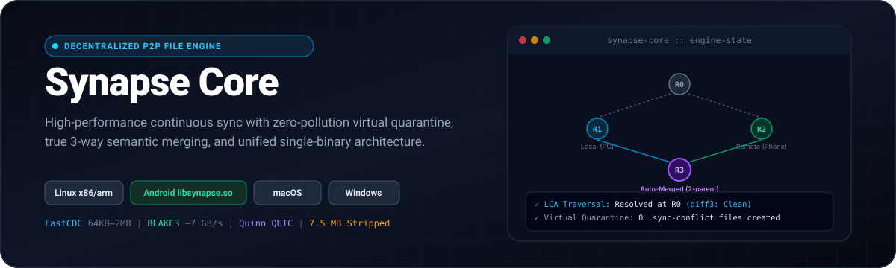
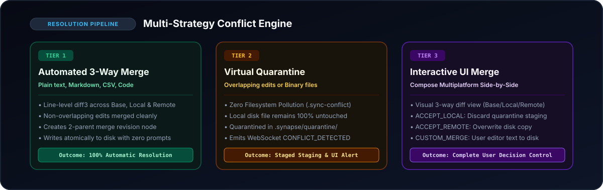
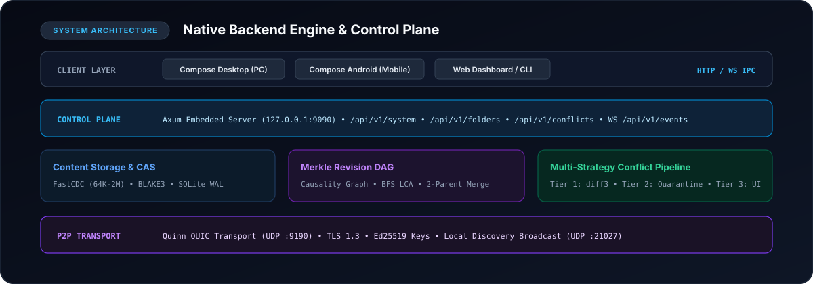

<div align="center">



<br/>

[](LICENSE)
[](https://www.rust-lang.org/)
[](https://ieeexplore.ieee.org/document/9055082)
[-00E676.svg?style=flat-square)](https://github.com/BLAKE3-team/BLAKE3)
[-8B5CF6.svg?style=flat-square)](https://github.com/quinn-rs/quinn)
[-3DDC84.svg?style=flat-square&logo=android)](https://developer.android.com/)
[](#building--cross-compilation)

</div>

---

## Executive Summary & Vision

**Synapse Core** is an embedded, peer-to-peer (P2P) continuous file synchronization and semantic conflict resolution engine. It is designed to act as the unified native backend for the Synapse ecosystem across **Desktop (Linux, macOS, Windows)**, **Mobile (Android)**, and **Web**.

Existing sync systems like **Syncthing** rely on opaque, fixed-size binary blocks (up to 16 MiB) and destructive file-renaming policies (`.sync-conflict-*`), which litter user directories, break internal wiki links, and cause silent build corruptions. Meanwhile, **CRDTs** suffer from massive operation-log bloat and syntactic corruption when applied blindly to raw filesystem files.

Synapse Core resolves these limitations through three foundational pillars:

1. **Non-Polluting Virtual Quarantine**: Conflicting edits never touch or rename the user's local working copy. Conflicting incoming versions are safely isolated in an internal virtual staging cache (`.synapse/quarantine/<conflict_id>.<ext>`) until reconciled.
2. **True 3-Way Semantic Merging**: By maintaining a lightweight revision **Merkle DAG** (ancestor tree), the engine identifies the **Lowest Common Ancestor (LCA)** to automatically merge non-overlapping edits in plain text, Markdown, CSV, JSON, and source code.
3. **Unified Single-Binary Architecture**: A single Rust codebase compiles into both a standalone executable daemon for PC and an executable shared library (`libsynapse.so`) for Android, sharing 100% of synchronization and conflict resolution logic.

---

## Architectural Comparison

| Dimension | Syncthing | File-Level CRDTs (Automerge / Yjs) | Synapse Core |
|---|---|---|---|
| **Conflict Strategy** | Renames files to `.sync-conflict-*` | Interweaves lines (causes syntax errors) | **3-Tier Pipeline** (Auto-Merge $\to$ Quarantine $\to$ Visual Diff) |
| **Filesystem Safety** | Destructive clutter on user disk | Not native to disk (requires custom formats) | **Zero Pollution** (Local copy is never renamed or overwritten) |
| **Chunking Engine** | Fixed-offset blocks (up to 16 MiB) | N/A (Operation logs / character ops) | **FastCDC v2020** (64 KiB min, 512 KiB avg, 2048 KiB max) |
| **1-Byte Shift Penalty** | **Total block invalidation** (re-transfers 16MB) | Operation log append overhead | **Zero downstream shift** (Gear hash re-synchronizes cut points) |
| **Cryptographic Hasher** | SHA-256 (~400 MB/s) | Custom hash chains | **BLAKE3** (~4–7 GB/s tree hashing per core) |
| **Mobile Memory (RAM)** | 80–150 MB (risks Android LMK eviction) | 100–300 MB (holds full causal graph in RAM) | **~15–25 MB idle** (lightweight streaming buffers) |
| **Network Transport** | TCP + TLS (drops on Wi-Fi $\leftrightarrow$ 5G handoff) | WebSockets / WebRTC | **Quinn QUIC (UDP)** with seamless Connection Migration |
| **Android Integration** | Separate wrapper codebase | Heavy JS/Wasm runtime | **Same native binary** (`libsynapse.so` nativeLibraryDir bypass) |

---

## Multi-Strategy Conflict Resolution Pipeline

When two devices edit a file concurrently, Synapse Core traces parent pointers in the Merkle Revision DAG using Breadth-First Search (BFS) to find the Lowest Common Ancestor ($R_{\text{base}}$). Divergence is handled through a deterministic 3-tier pipeline:

<div align="center">
  
</div>

### Tier 1: Automated 3-Way Semantic Merge
For plain text, Markdown, CSV, JSON, and source code files:
* Compares lines from $R_{\text{base}}$, $R_{\text{local}}$, and $R_{\text{remote}}$ using a line-level diff3 algorithm.
* If changes occurred in separate sections of the file, synthesizes the merged output automatically.
* Writes the merged file atomically to disk, creates a 2-parent merge revision node, and broadcasts the resolved state to all peers.
* **Result:** 0 prompts, 0 filesystem clutter, zero human intervention needed.

### Tier 2: Zero-Pollution Virtual Quarantine
Triggered when changes overlap on the same lines or when conflicting files are binary (images, videos, SQLite, PDFs, archives):
* **Disk Integrity:** The user's local working copy is **never renamed** and **never overwritten**.
* **Quarantine Staging:** The incoming remote payload is assembled into an internal virtual staging folder: `.synapse/quarantine/<conflict_id>.<ext>`.
* **Database Registration:** Logged in the SQLite `quarantine_conflicts` table.
* **UI Signal:** Pushes a `CONFLICT_DETECTED` event over WebSocket to connected client interfaces.

### Tier 3: Interactive UI Visual Merge Tool
The user inspects side-by-side diff hunks in the Synapse UI and chooses an explicit action:
* `ACCEPT_LOCAL`: Discards the quarantined entry and keeps the local working file.
* `ACCEPT_REMOTE`: Replaces the local file with the quarantined payload atomically.
* `CUSTOM_MERGE`: Submits user-edited text from the UI merge editor, writing it atomically to disk and committing a 2-parent merge revision.
* `KEEP_BOTH`: Saves the remote copy alongside with an explicit non-destructive sidecar name (e.g., `file.conflict-<id>.ext`).

---

## System Architecture

<div align="center">
  
</div>

### Core Subsystems

* **FastCDC Chunker ([`src/chunker/`](src/chunker/mod.rs))**: Implements normalized rolling Gear hashing with minimum 64 KiB, target 512 KiB, and maximum 2048 KiB chunk sizes.
* **Content-Addressable Storage ([`src/storage/`](src/storage/mod.rs))**: Deduplicated chunk store in `.synapse/blocks/` with SQLite reference-counted indexing in Write-Ahead Logging (`WAL`) mode.
* **Merkle Revision DAG ([`src/dag/`](src/dag/mod.rs))**: Causality graph tracking parent hashes, manifest Merkle roots, sequence counters, author device fingerprints, and BFS LCA resolution.
* **P2P Transport ([`src/p2p/`](src/p2p/mod.rs))**: Quinn-powered QUIC multiplexed transport with TLS 1.3, Ed25519 node identities, and local UDP peer discovery on port `21027`.
* **Local Control Plane ([`src/api/`](src/api/mod.rs))**: Embedded Axum HTTP REST and WebSocket server running on `127.0.0.1:9090` for IPC communication with desktop and mobile user interfaces.

---

## Local Control Plane: REST & WebSocket API Documentation

The Synapse Core daemon exposes an internal HTTP and WebSocket API on `127.0.0.1:9090` (configurable via `--addr` and `--port`). All endpoints are CORS-enabled for web and desktop UI integration.

### Base URL & Headers
```http
http://127.0.0.1:9090/api/v1
Content-Type: application/json
```
If started with `--token <token>`, include the authorization header:
```http
Authorization: Bearer <token>
```

---

### Endpoints Overview

| Method | Endpoint | Description |
|---|---|---|
| `GET` | `/system/status` | Engine uptime, peer count, memory footprint, sync state |
| `GET` | `/folders` | List configured sync folders, paths, and status |
| `POST` | `/folders` | Register a new monitored folder with custom policy |
| `GET` | `/conflicts` | List active quarantined conflicts awaiting resolution |
| `GET` | `/conflicts/:id` | Get metadata for a specific quarantined conflict |
| `GET` | `/conflicts/:id/base` | Fetch raw text/binary of the Lowest Common Ancestor |
| `GET` | `/conflicts/:id/local` | Fetch raw text/binary of the current local disk file |
| `GET` | `/conflicts/:id/remote` | Fetch raw text/binary of the quarantined remote file |
| `GET` | `/conflicts/:id/diff` | Get structured 3-way diff hunks (`base`, `local`, `remote`) |
| `POST` | `/conflicts/:id/resolve` | Submit user decision (`ACCEPT_LOCAL`, `ACCEPT_REMOTE`, `CUSTOM_MERGE`, `KEEP_BOTH`) |
| `WS` | `/events` | Bi-directional WebSocket stream for real-time notifications |

---

### 1. System Status
Retrieves daemon health, device identity, connected peer count, and resource utilization.

* **Endpoint:** `GET /api/v1/system/status`
* **Response:** `200 OK`

```json
{
  "device_id": "d51dd80953132f4cbd8a751f5294f5a361a1af85f3c65aad2c2191b8f4f4b864",
  "uptime_seconds": 1420,
  "peer_count": 2,
  "sync_state": "IDLE",
  "version": "1.0.0",
  "monitored_folders_count": 3,
  "pending_conflicts_count": 1,
  "memory_footprint_bytes": 10485760
}
```

---

### 2. Monitored Folders

#### List Folders
* **Endpoint:** `GET /api/v1/folders`
* **Response:** `200 OK`

```json
[
  {
    "folder_id": "notes_vault",
    "local_path": "/home/user/Notes",
    "conflict_policy": "THREE_WAY_AUTO",
    "is_paused": false,
    "files_count": 142
  }
]
```

#### Register Folder
Registers a directory for continuous synchronization and starts the background filesystem watcher.

* **Endpoint:** `POST /api/v1/folders`
* **Request Body:**
```json
{
  "folder_id": "notes_vault",
  "local_path": "/home/user/Notes",
  "conflict_policy": "THREE_WAY_AUTO"
}
```
* **Conflict Policies:** `THREE_WAY_AUTO` (default), `LWW` (Last-Write-Wins), `MANUAL`.
* **Response:** `201 Created`

---

### 3. Conflict Inspection

#### List Pending Conflicts
Returns all files currently staged in virtual quarantine awaiting resolution.

* **Endpoint:** `GET /api/v1/conflicts`
* **Response:** `200 OK`

```json
[
  {
    "conflict_id": "cnf_8f93e1a0",
    "folder_id": "notes_vault",
    "relative_path": "projects/spec.md",
    "base_revision": "rev_root_001",
    "local_revision": "rev_local_002",
    "remote_revision": "rev_remote_003",
    "staged_payload_path": "/home/user/.synapse/quarantine/cnf_8f93e1a0.md",
    "status": "PENDING",
    "detected_at": 1730560120000000000
  }
]
```

#### Fetch Raw Versions
* `GET /api/v1/conflicts/:id/base` $\rightarrow$ Returns the Lowest Common Ancestor content (`Content-Type: text/plain` or octet-stream).
* `GET /api/v1/conflicts/:id/local` $\rightarrow$ Returns the current disk version.
* `GET /api/v1/conflicts/:id/remote` $\rightarrow$ Returns the quarantined incoming version.

#### Inspect 3-Way Diff Hunks
Returns pre-computed diff hunks ready for side-by-side rendering in visual UI diff dialogs.

* **Endpoint:** `GET /api/v1/conflicts/:id/diff`
* **Response:** `200 OK`

```json
{
  "conflict_id": "cnf_8f93e1a0",
  "folder_id": "notes_vault",
  "relative_path": "projects/spec.md",
  "base": "# Spec\nTimeout: 30\n",
  "local": "# Spec\nTimeout: 60\n",
  "remote": "# Spec\nTimeout: 120\n",
  "hunks": [
    {
      "hunk_type": "UNCHANGED",
      "base_lines": ["# Spec"],
      "local_lines": ["# Spec"],
      "remote_lines": ["# Spec"]
    },
    {
      "hunk_type": "CONFLICT",
      "base_lines": ["Timeout: 30"],
      "local_lines": ["Timeout: 60"],
      "remote_lines": ["Timeout: 120"]
    }
  ]
}
```

* **Hunk Types:** `UNCHANGED`, `LOCAL_CHANGE`, `REMOTE_CHANGE`, `IDENTICAL_CHANGE`, `CONFLICT`.

---

### 4. Conflict Resolution
Submits a user decision to reconcile a quarantined conflict.

* **Endpoint:** `POST /api/v1/conflicts/:id/resolve`

#### Option A: Accept Local
Keeps the local disk copy unchanged and purges the quarantine staging entry.
```json
{
  "action": "ACCEPT_LOCAL"
}
```

#### Option B: Accept Remote
Replaces the local disk copy with the quarantined version atomically and indexes the remote revision.
```json
{
  "action": "ACCEPT_REMOTE"
}
```

#### Option C: Custom Merge (UI Combined Draft)
Writes custom merged text submitted from the UI editor to disk and creates a 2-parent merge revision.
```json
{
  "action": "CUSTOM_MERGE",
  "merged_content": "# Spec\nTimeout: 90\n"
}
```

#### Option D: Keep Both
Preserves the local file and saves the remote version alongside non-destructively (`spec.conflict-cnf_8f93e1a0.md`).
```json
{
  "action": "KEEP_BOTH"
}
```

* **Response:** `200 OK`

---

### 5. WebSocket Event Stream
Clients connect to receive bi-directional real-time event updates.

* **Endpoint:** `ws://127.0.0.1:9090/api/v1/events`

#### Event: Conflict Detected (`CONFLICT_DETECTED`)
Emitted immediately when an overlapping conflict or binary collision is quarantined:
```json
{
  "event": "CONFLICT_DETECTED",
  "data": {
    "conflict_id": "cnf_8f93e1a0",
    "folder_id": "notes_vault",
    "relative_path": "projects/spec.md",
    "mime_type": "text/markdown",
    "local_version": {
      "author": "Desktop-Workstation",
      "mtime": 1730560000,
      "size": 4210
    },
    "remote_version": {
      "author": "Pixel-8-Mobile",
      "mtime": 1730560120,
      "size": 4350
    },
    "auto_merge_attempted": true,
    "overlapping_lines_count": 1
  }
}
```

#### Additional Events
* `FILE_CHANGED`: `{ "folder_id": "...", "relative_path": "...", "revision": "..." }`
* `CONFLICT_RESOLVED`: `{ "conflict_id": "...", "action": "ACCEPT_LOCAL" }`
* `SYNC_STARTED`: `{ "folder_id": "..." }`
* `SYNC_COMPLETED`: `{ "folder_id": "...", "files_synced": 5 }`
* `PEER_CONNECTED`: `{ "peer_id": "...", "addr": "192.168.1.42:9190" }`
* `PEER_DISCONNECTED`: `{ "peer_id": "..." }`

Ping / Pong is supported by sending the text message `"ping"`, which returns `"pong"`.

---

## Cross-Platform Compilation & Deployment Strategy

To allow Desktop and Mobile clients to share 100% of the synchronization logic, the repository produces targeted artifacts from a single Rust codebase.

### Desktop Deployment (Linux, macOS, Windows)
Build the stripped, standalone executable:
```bash
./scripts/build-desktop.sh
```
* **Output:** [`bin/synapse-core`](bin/synapse-core) (**7.48 MB**, stripped and optimized).
* **Execution in Kotlin Desktop:**
  ```kotlin
  val process = ProcessBuilder("./bin/synapse-core", "--home", configDir.absolutePath)
      .redirectErrorStream(true)
      .start()
  ```

### Android Execution Mechanics (`libsynapse.so`)
Since Android 10, executing raw binaries located in standard app storage (`/data/data/`) is blocked by SELinux **W^X** (Write XOR Execute) policies.

**The Solution:**
1. Cross-compile for Android ABIs (`arm64-v8a`, `armeabi-v7a`, `x86_64`) via `scripts/build-android.sh`.
2. Rename the binary artifact to `libsynapse.so` and copy it into:
   ```text
   app/androidApp/src/main/jniLibs/arm64-v8a/libsynapse.so
   ```
3. During APK installation, Android extracts `libsynapse.so` into the application's `nativeLibraryDir` with executable permissions (`+x`).
4. An Android foreground service spawns the daemon via `ProcessBuilder`:
   ```kotlin
   val nativeLibDir = context.applicationInfo.nativeLibraryDir
   val binary = File(nativeLibDir, "libsynapse.so")
   val process = ProcessBuilder(binary.absolutePath, "--home", appFilesDir.absolutePath)
       .redirectErrorStream(true)
       .start()
   ```
*(In addition, C ABI entrypoints [`synapse_start`](src/lib.rs#L210), [`synapse_stop`](src/lib.rs#L273), and [`synapse_is_running`](src/lib.rs#L263) are exported in `src/lib.rs` for in-memory JNI invocation if desired).*

---

## Quickstart & Verification

### 1. Run the Automated Live Demo
Verify the entire engine, REST API, watcher, and conflict resolution in a single automated test run:
```bash
./scripts/demo-test.sh
```

### 2. Run the Test Suite
```bash
cargo test -- --nocapture
```

### 3. Start the Daemon Manually
```bash
# Launch daemon on default ports (API :9090, QUIC :9190, Discovery :21027)
./bin/synapse-core -H ~/.synapse -p 9090 run

# Or query running daemon status from terminal:
./bin/synapse-core status

# Register a folder via CLI:
./bin/synapse-core folders add -i notes_vault -p ~/Notes --policy THREE_WAY_AUTO
```

---

## CLI Reference

```text
Decentralized File Synchronization & 3-Way Conflict Resolution Engine

Usage: synapse-core [OPTIONS] [COMMAND]

Commands:
  run        Start the continuous synchronization daemon (default)
  status     Query status of the running Synapse Core daemon
  folders    Manage synchronized folders
  conflicts  Inspect or resolve quarantined conflicts
  help       Print this message or the help of the given subcommand(s)

Options:
  -H, --home <HOME>          Synapse root home directory [env: SYNAPSE_HOME=]
  -c, --config <CONFIG>      Optional configuration file path
  -a, --addr <ADDR>          Control plane HTTP & WS bind address [default: 127.0.0.1]
  -p, --port <PORT>          Control plane HTTP & WS port [default: 9090]
      --p2p-port <PORT>      P2P QUIC transport listening port [default: 9190]
      --discovery-port <P>   Local UDP discovery broadcast port [default: 21027]
      --token <TOKEN>        Security authentication token [env: SYNAPSE_TOKEN=]
      --device-name <NAME>   Custom human-readable device name
  -h, --help                 Print help
  -V, --version              Print version
```

---

## License

This project is licensed under the [MIT License](LICENSE).
